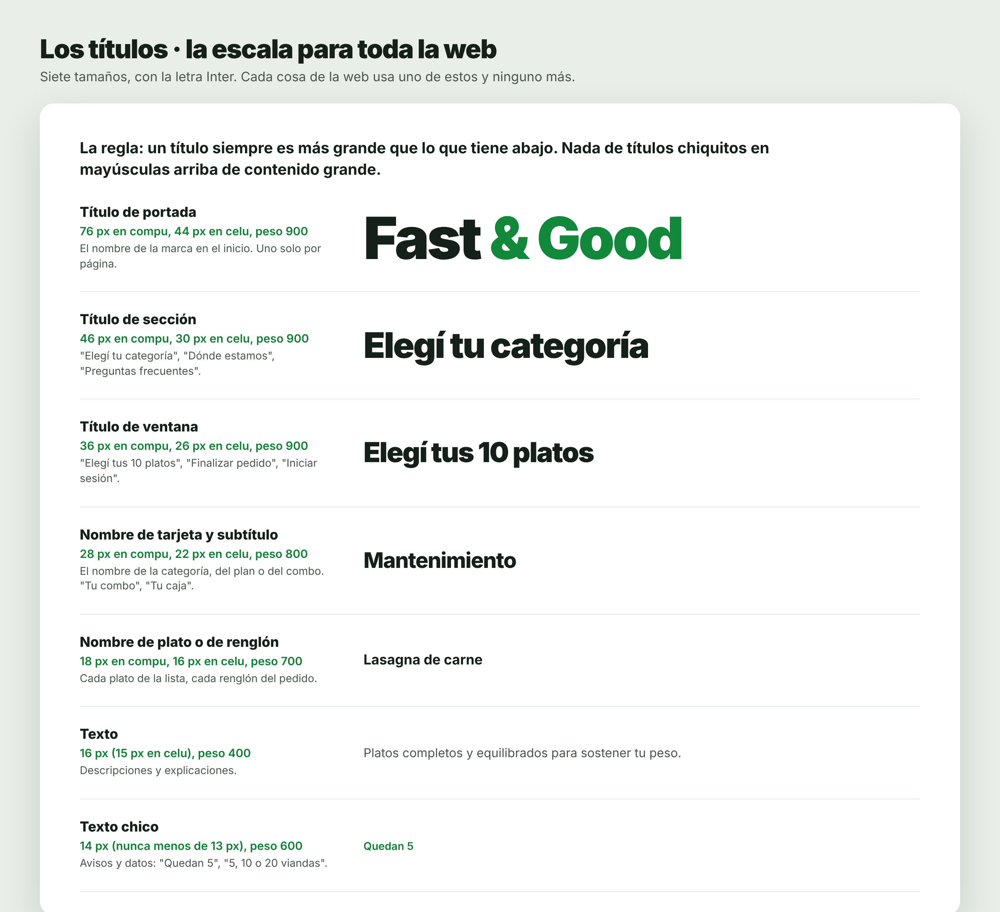
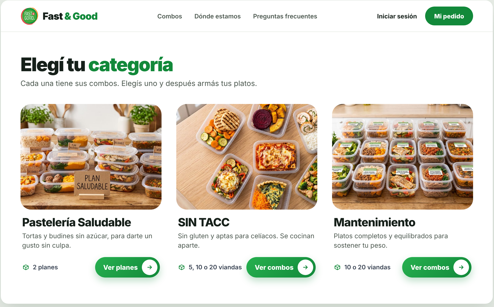
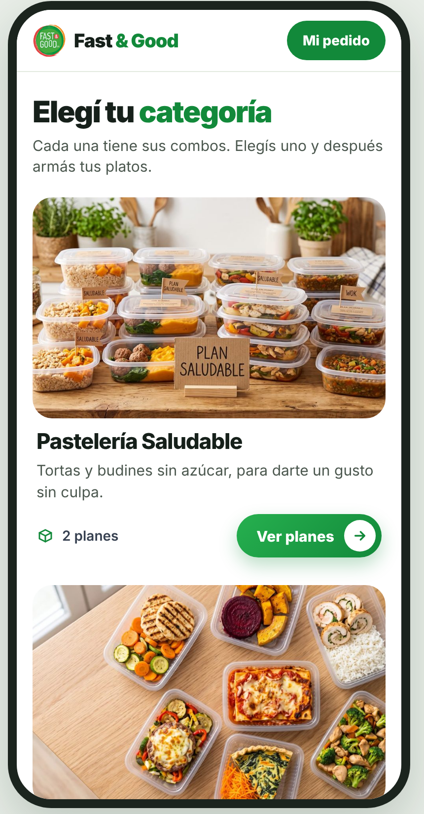
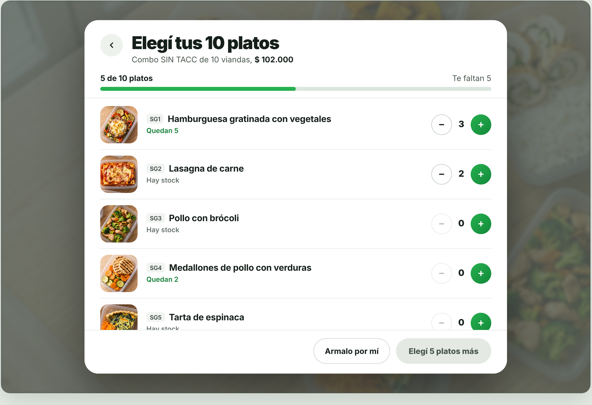
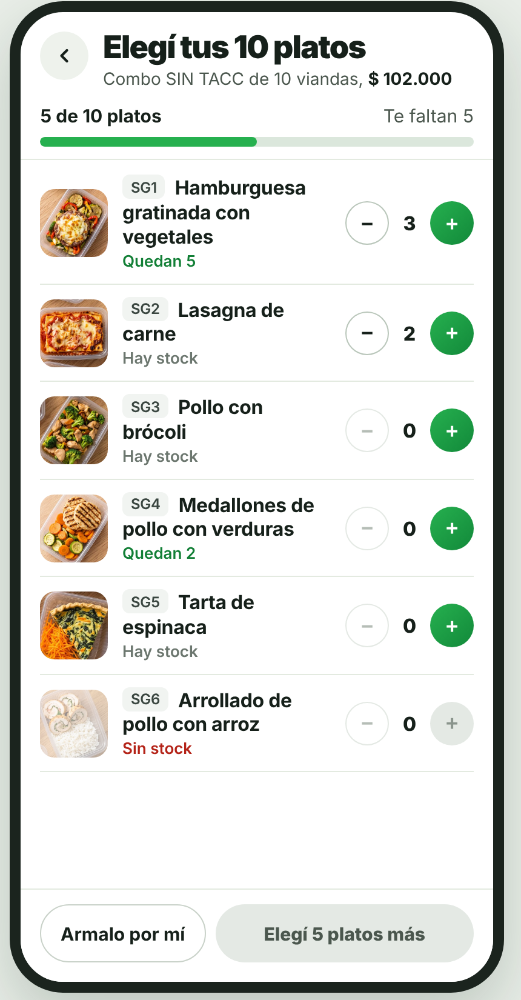

# Cambios de diseño de la tienda · versión 2 (rama mejoras-fastgood)

Tres cambios, todos visuales. No cambian datos, rutas, lo que va al carrito ni lo
que se manda al servidor.

1. **La letra Inter en toda la web** (tienda y panel).
2. **Los títulos con una escala de 7 tamaños**, y que se respeten: un título siempre
   es más grande que lo que tiene abajo.
3. **La tarjeta nueva de categoría y plan** (nivel 1): la "A · La foto manda".

La ventana de armar combo **queda como está**: solo se le arreglan los títulos.

Las imágenes de esta carpeta muestran cómo tiene que quedar. Los platos y los textos
de las imágenes son de ejemplo: el código usa los datos reales de la base.

| Imagen | Qué muestra |
|---|---|
| `1-tarjetas-compu.png` | La tarjeta nueva en la compu, de a 3 por fila |
| `2-tarjetas-celu.png` | La tarjeta nueva en el celu, una abajo de la otra |
| `3-ventana-compu.png` | La ventana de armar combo de hoy, con los títulos arreglados (compu) |
| `4-ventana-celu.png` | Lo mismo en el celu |
| `5-escala-de-titulos.png` | Los 7 tamaños de letra |

---

## 1. La letra Inter

- En cada `.html` que carga Figtree desde Google Fonts (`index.html`, `login.html` y
  los de `pages/`), el link pasa a ser:
  `https://fonts.googleapis.com/css2?family=Inter:wght@400;500;600;700;800;900&display=swap`
- En `frontend/src/css/index.css` y `frontend/src/css/global.css`, en `--fuente`,
  "Figtree" pasa a "Inter". El resto de la lista queda igual.

---

## 2. La escala de títulos



| Nivel | Para qué | Compu | Celu | Peso |
|---|---|---|---|---|
| 1 | Título de portada ("Fast & Good") | 76px | 44px | 900 |
| 2 | Título de sección ("Elegí tu categoría", "Dónde estamos", "Preguntas frecuentes") | 46px | 30px | 900 |
| 3 | Título de ventana ("Elegí tus 10 platos", "Finalizar pedido", "Iniciar sesión") | 36px | 26px | 900 |
| 4 | Nombre de tarjeta y subtítulo (nombre de la categoría, del plan o del combo) | 28px | 22px | 800 |
| 5 | Nombre de plato o de renglón | 18px | 16px | 700 |
| 6 | Texto (descripciones) | 16px | 15px | 400 |
| 7 | Texto chico (avisos y datos: "Quedan 5", "5, 10 o 20 viandas") | 14px | 14px | 600 |

- Los niveles 1 a 4 llevan `letter-spacing: -.03em` y `line-height` entre 1.05 y 1.1.
- Ningún texto de la web por debajo de 13px.
- Los 7 tamaños van como perillas en `:root` de los dos CSS, así se cambian en un solo lugar.

**La regla:** un título siempre es más grande que lo que tiene abajo. Nada de
rotulitos chicos en mayúsculas haciendo de título arriba de contenido grande.

Lo que hoy está mal:
- En el celu, "ELEGÍ TU CATEGORÍA" sale chiquito y en mayúsculas, con cosas gigantes
  arriba y abajo. Es un título de sección: **nivel 2**, sin mayúsculas.
- En la ventana de armar combo, "Elegí 10 platos" es chiquito y los platos son grandes.

---

## 3. La tarjeta nueva (nivel 1, `renderizarTarjetasDelIndex`)





**Sin recuadro, sin sombra y sin borde.** La foto manda y el texto va directo sobre
el fondo de la página.

| Parte | Cómo va |
|---|---|
| Foto | Arriba, a todo el ancho. Forma 4:3 en compu y 16:10 en celu. Esquinas de 26px en compu y 20px en celu. **Sin nada encima**: se saca el chip "3 combos" / "2 planes" y el nombre de arriba de la foto |
| Nombre | Debajo de la foto, **nivel 4** (28px compu, 22px celu, peso 800), color de título |
| Descripción | Debajo del nombre, **nivel 6** (16px compu, 15px celu), gris. Si no tiene, no va |
| Fila de abajo | Izquierda: ícono de cajita (SVG en línea, verde #12893a, 18px) + el dato, **nivel 7**, sin cortarse de línea. Derecha: el botón |
| El dato | PLAN: los tamaños de sus combos, "5, 10 o 20 viandas" (`combo.cantidad` sin repetir, de menor a mayor, separados con ", " y el último con " o "; si hay uno solo, "7 viandas"). CATEGORÍA: "2 planes" o "1 plan" |
| Botón | Corto, con el MISMO diseño que "¡Lo quiero!": verde con degradé, sombra y el círculo blanco con la flecha. 50px de alto en compu y 44px en celu. El texto que ya tiene (Ver combos / Ver planes) |
| Separación | En compu, 3 por fila con 36px entre tarjetas. En celu, una abajo de la otra con 28px |

El nombre y el dato tienen 4px de aire a los costados, para que no queden pegados al
borde de la foto.

**No se tocan:** el nivel 2 (planes de una categoría) ni la tarjeta del combo (nivel 3).

---

## 4. La ventana de armar combo: solo los títulos





Es la ventana de hoy. Lo único que cambia es el tamaño y el orden de los textos de arriba:

| Hoy | Cómo queda |
|---|---|
| Arriba, chico y gris: "SIN TACC". Abajo, en negrita: "10 viandas · $ 102.000" | El título de la ventana, **nivel 3**: "Elegí tus 10 platos" (con la cantidad real del combo). Debajo, como texto (**nivel 6**): "Combo SIN TACC de 10 viandas, **$ 102.000**" |
| "Elegí 10 platos" chiquito, al lado de la barra | Pasa a "5 de 10 platos" (en negrita, **nivel 6**) y a la derecha "Te faltan 5" en gris. Debajo, la barra verde como ahora |
| Nombre de cada plato | **Nivel 5** (18px compu, 16px celu, peso 700), con el código adelante |
| "Quedan 5", "Hay stock", "Sin stock" | **Nivel 7** |

Quedan igual: la flecha para volver, la lista, los botones − y +, "Armalo por mí" y
el botón principal.

---

## El prompt para Claude Code

```
Rama: mejoras-fastgood. NO hagas commit ni push. No toques la base, ni el .env,
ni el backend. Solo el front: los .html, los CSS (index.css y global.css),
renderizadoCatalogo.js y armarCombo.js.

Antes de planear, leé docs/diseno-tienda-v2/README.md y mirá las 5 imágenes de esa
carpeta: así tiene que quedar.

PRIMERO mostrame el plan y esperá mi OK. Seguí la sección "El JavaScript de una
pantalla, a mi manera" del CLAUDE.md (con if, sin ternarios).

## 1. Letra Inter en toda la web
Como dice la sección 1 del README. Hacé git grep de "Figtree" y avisame si queda
en algún otro lado.

## 2. Escala de títulos
Los 7 tamaños de la sección 2 del README, como perillas en :root de los dos CSS.
Revisá TODAS las pantallas: la tienda (inicio, los 3 niveles, armar combo,
Mi pedido, Finalizar pedido, iniciar sesión) y el panel (pedidos, envíos, stock,
cocinero, heladera). En el plan, mostrame una tabla por pantalla:
  texto | tamaño de hoy | nivel que le toca | cómo queda
Cada título tiene que ser una etiqueta de título de verdad (h1, h2, h3) y en orden:
un solo h1 por página, después h2, después h3.

## 3. Tarjeta nueva del nivel 1 (renderizarTarjetasDelIndex)
Como dice la sección 3 del README. El texto del dato ("5, 10 o 20 viandas") armalo
con una función chiquita aparte, ej. textoTamanios(cantidades).
Sacá las reglas viejas de esta tarjeta para que no queden pisándose, y todo con
.tarjeta-del-index adelante: la tarjeta del combo (nivel 3) usa clases parecidas
y NO se tiene que romper. El nivel 2 no se toca.

## 4. Ventana de armar combo: solo los títulos
Como dice la sección 4 del README. NO cambies el diseño de la ventana, ni la
lógica, ni lo que va al carrito: solo los textos de arriba y sus tamaños.

## 5. Al terminar
- Miralo a 390px y a 1366px: el inicio, un plan por dentro, la ventana de armar
  combo de punta a punta hasta "Agregar al pedido", y una pantalla del panel.
- Pasame una tabla con qué cambiaste en cada archivo.
```
