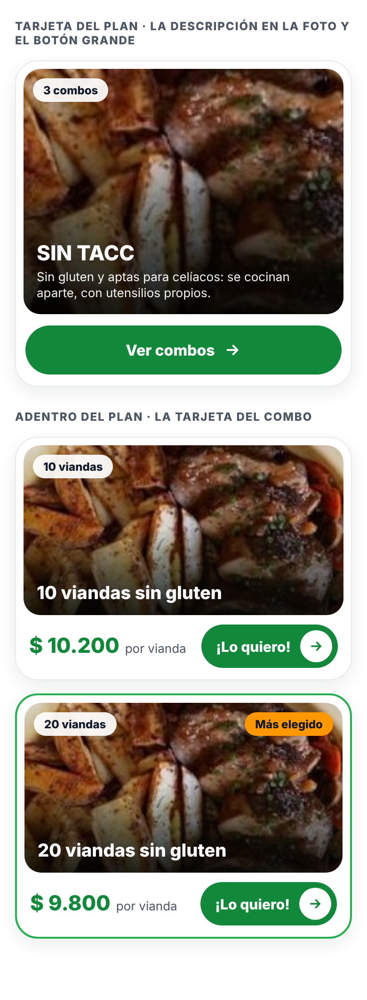
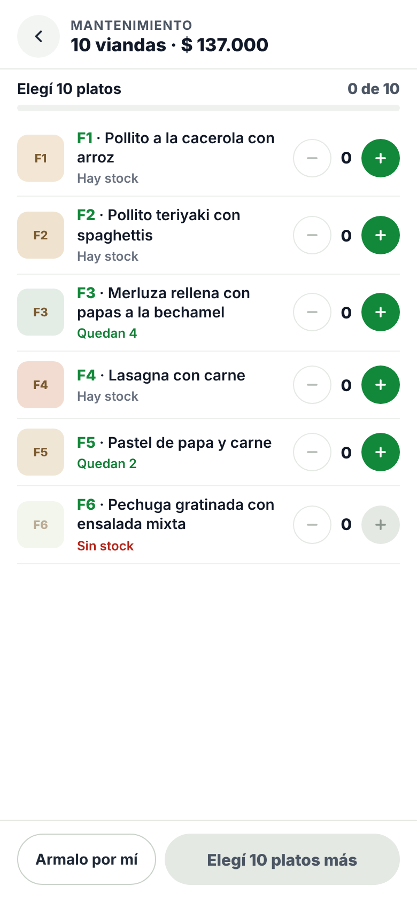
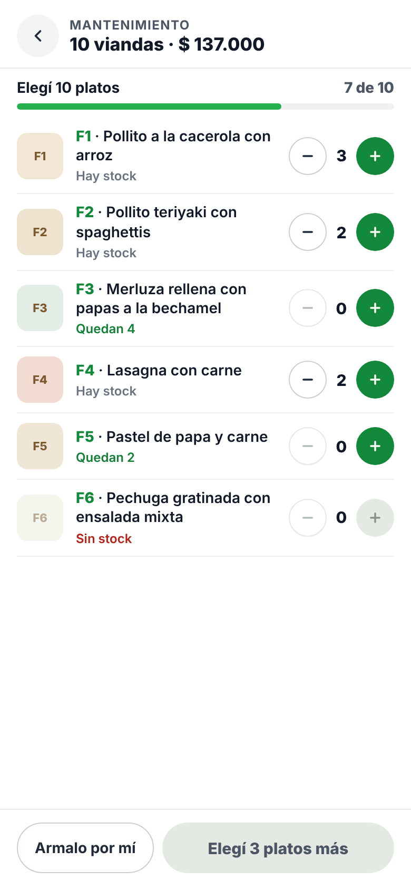
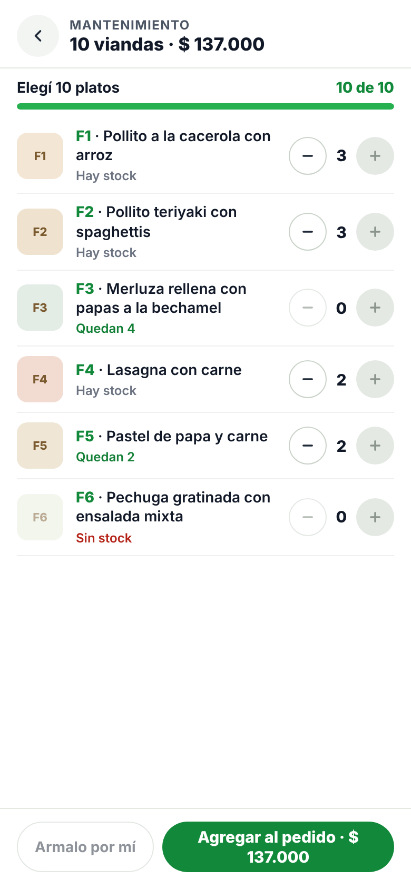

# Diseño de la tienda (rama mejoras-fastgood)

Este documento dice cómo tienen que quedar 3 cosas de la tienda. Las imágenes
están en esta misma carpeta, a 390px de ancho (celu). En compu se mantiene lo
mismo, pero más ancho.

Archivos que se tocan:
- `frontend/src/js/renderizadoCatalogo.js` (tarjetas)
- `frontend/src/js/armarCombo.js` (armar combo)
- `frontend/src/css/index.css`
- `frontend/index.html` (solo si hace falta, en el modal del combo)

Colores (los que ya usa la web):

| Para qué | Color |
|---|---|
| Verde de botones y precio | `#12893a` |
| Verde del borde "Más elegido" | `#26b04f` |
| Naranja del sello "Más elegido" | `#ff9800` |
| Texto oscuro | `#111827` |
| Texto gris | `#4b5563` |
| Rojo de "Sin stock" | `#b42318` |
| Bordes finitos | `#e6ebe6` |

---

## 1. Tarjeta del index, nivel 1 (`renderizarTarjetasDelIndex`)

Es la tarjeta de ARRIBA de la imagen.

| Parte | Cómo va |
|---|---|
| Tarjeta | Blanca, borde de 1px, esquinas de 24px, sombra suave, 8px de margen interno |
| Foto | 260px de alto en celu, esquinas de 18px, con degradé negro de abajo hacia arriba (para que se lea el texto) |
| Chip arriba a la izquierda | El que ya existe (`tarjeta-combo-cantidad`): fondo blanco, "3 combos" / "2 planes" |
| Nombre | ENCIMA de la foto, abajo a la izquierda. Blanco, 22px, negrita |
| Descripción | Debajo del nombre, ENCIMA de la foto. Blanco, 13px. Si no tiene descripción, no va nada |
| Precio | NO VA. Se saca "Desde", el precio y "por vianda" |
| Botón | Abajo de la foto, a todo el ancho, 52px de alto, verde, bien redondeado. Texto: el que ya tiene (`tarjeta.textoBoton`: "Ver combos" o "Ver planes") + flecha → |

---

## 2. Tarjeta del combo, nivel 3 (`renderizarCombosDelPlan`)

Son las 2 tarjetas de ABAJO de la imagen 1. Es la MISMA tarjeta que hay hoy;
solo cambian los precios.

| Parte | Cómo va |
|---|---|
| Foto | Igual que hoy: chip "10 viandas" arriba a la izquierda, nombre del combo en blanco abajo |
| Sello "Más elegido" | Igual que hoy: naranja arriba a la derecha, y la tarjeta con borde verde de 2px |
| Precio total del combo | NO VA (se saca `textoPrecio`) |
| Precio por vianda | A la izquierda: "$ 10.200" en verde, 22px, negrita, y al lado "por vianda" en gris, 13px |
| Botón "¡Lo quiero!" | Igual que hoy, a la derecha, alineado al medio con el precio |

Ojo: las clases `tarjeta-combo-*` las usan las dos tarjetas (nivel 1 y nivel 3).
Cambiar el CSS de una no tiene que romper la otra.

## Nivel 2 (`renderizarPlanesDeLaCategoria`)

NO se toca.

---

## 3. Armar combo (`renderizarMenuCombo`)

Sin nada de personalizado. Tres estados:

| Recién abierto | Eligiendo (7 de 10) | Completo (10 de 10) |
|---|---|---|
|  |  |  |

| Parte | Cómo va |
|---|---|
| Arriba | Flecha para volver, el nombre del plan en gris chico y "10 viandas · $ 137.000" |
| Barra | "Elegí 10 platos" a la izquierda, "7 de 10" a la derecha (verde cuando está completo), y la barra verde |
| Renglón de plato | Finito: foto de 44px redondeada · código en verde + nombre · debajo el aviso · a la derecha − cantidad + |
| Aviso del plato | "Quedan N" en verde si hay pocas · "Sin stock" en rojo si no hay (SOLO "Sin stock", sin "podés pedirlo personalizado") |
| Descripción del plato | NO va en el renglón |
| Plato sin stock | Foto más clarita y el + apagado |
| Botones de abajo | "Armalo por mí" (blanco con borde) y el principal: gris "Elegí 3 platos más" mientras falta; verde "Agregar al pedido · $ 137.000" cuando está completo |

### Lo de personalizado

- NO se dibuja nada: ni el botón "✎ Personalizar", ni el campo de texto, ni los
  renglones de personalizados, ni la nota "Los platos personalizados se cocinan aparte…".
- NO se borran las funciones ni las variables de personalizado
  (`platoPersonalizando`, `agregarPlatoPersonalizado`, `cambiarCantidadPersonalizado`,
  las acciones `personalizado-*`, el campo `personalizado` de lo que va al carrito).
  Solo se dejan de dibujar. Se retoma más adelante.
